# PM Compass v2 — Architecture

This document describes the system design: components, data flows, security boundaries, and design decisions. It is derived from [`context.md`](./context.md), which holds the file-level details and the "where to change things" table. Read this first for the big picture and `context.md` when you are about to edit.

## Contents

1. [System overview](#1-system-overview)
2. [Component architecture](#2-component-architecture)
3. [Authentication and credentials](#3-authentication-and-credentials)
4. [Ingestion pipelines](#4-ingestion-pipelines)
5. [Query pipeline](#5-query-pipeline)
6. [Text-to-SQL subsystem](#6-text-to-sql-subsystem)
7. [Data architecture](#7-data-architecture)
8. [Security model](#8-security-model)
9. [LLM abstraction and prompt management](#9-llm-abstraction-and-prompt-management)
10. [Frontend architecture](#10-frontend-architecture)
11. [Deployment and operations](#11-deployment-and-operations)
12. [Evaluation](#12-evaluation)
13. [Design decisions and trade-offs](#13-design-decisions-and-trade-offs)
14. [Known limitations and tech debt](#14-known-limitations-and-tech-debt)
15. [Extension points](#15-extension-points)

---

## 1. System overview

PM Compass is a single-page React app backed entirely by Supabase. There is no custom application server. All server logic runs in Deno Edge Functions, and all state lives in Postgres.

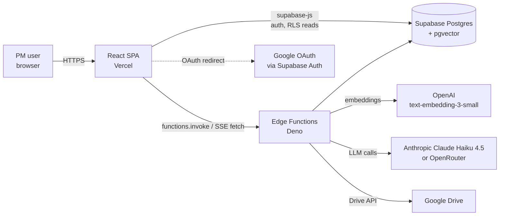

Three product capabilities share one data plane:

| Capability | Retrieval engine | Source data |
|---|---|---|
| Natural-language document search | Vector search (pgvector) | Drive docs, slides, PDFs, sheets |
| Structured data Q&A | Text-to-SQL over per-user tables | Sheets and CSVs |

The router in `search-documents` picks the engine per query. If the SQL route fails for any reason, it falls back to the vector route.

---

## 2. Component architecture

### 2.1 Runtime components

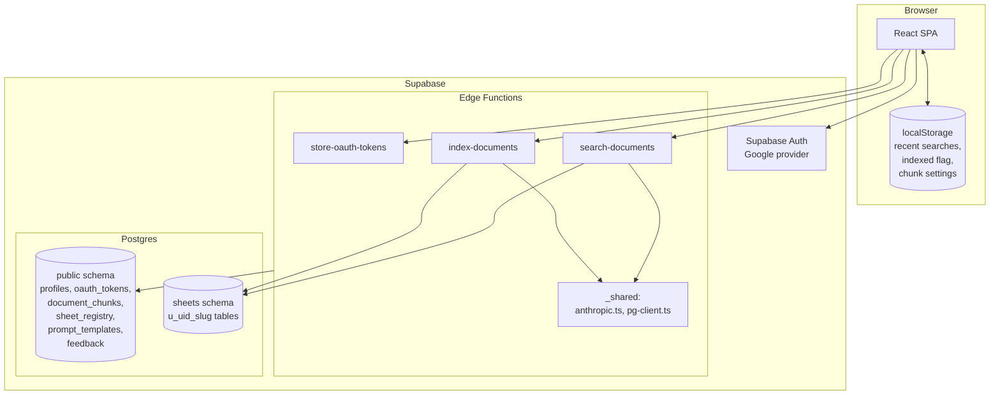

### 2.2 Edge function responsibilities

| Function | Trigger | Auth | Reads | Writes | External calls |
|---|---|---|---|---|---|
| `store-oauth-tokens` | After Google sign-in | User JWT | none | `oauth_tokens` | none |
| `index-documents` | Dashboard auto-index, Settings re-index | User JWT | `oauth_tokens` | `document_chunks`, `sheets.*`, `sheet_registry`, `oauth_tokens` (refresh) | Google Drive and token endpoint, OpenAI |
| `search-documents` | Search page, summarize button | User JWT | `document_chunks`, `sheet_registry`, `sheets.*`, `prompt_templates` | none | OpenAI, Anthropic/OpenRouter |

Common pattern in the user-facing functions:

1. Read `Authorization`, build a user-scoped client, call `auth.getUser()`.
2. Use the user client for RLS-protected reads, and a service-role client for privileged writes.
3. Return JSON with permissive CORS headers.

`_shared/` is the only cross-function code: the LLM client and the direct Postgres client.

---

## 3. Authentication and credentials

### 3.1 Google (via Supabase Auth)

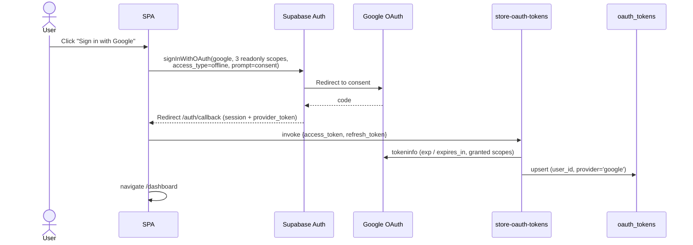

- The scopes are `drive.metadata.readonly`, `drive.readonly`, `documents.readonly`. They are readonly by design and must not change without discussion.
- The Google `provider_token` exists only in the session immediately after sign-in, so `AuthCallback` must persist it right then.
- Refresh is lazy and server-side. `index-documents` refreshes the token if it expires within 60 seconds and writes the new token back.
- `oauth_tokens` is `UNIQUE(user_id, provider)`.

---

## 4. Ingestion pipelines

### 4.1 Drive indexing

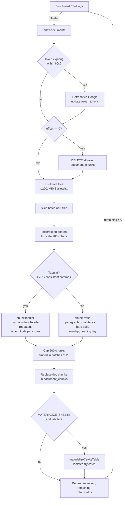

Key properties:

- **Client-driven pagination.** The function processes 3 files per call and returns `remaining`. The client loops with `offset`. This keeps each invocation inside Edge Function time and memory limits.
- **Clean-slate on first batch.** `offset === 0` deletes all of the user's chunks.
- **Isolation of the SQL mirror.** Materialization failures never affect vector indexing.
- **Chunk shape.** Each chunk is prefixed with `Document: <title>`. Metadata carries `source`, `content_type`, and optionally `account_ids` (tabular) and `heading` (prose).

### 4.2 Materialization (CSV → typed Postgres table)

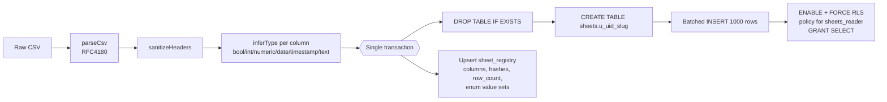

The `sheet_registry.columns` JSON is the schema prompt for the SQL planner. Columns with at most 25 distinct values store their complete value set (`enum: true`), so the planner can write exact filters. Other columns store 3 sample values.

Re-materialization is drop-and-rebuild. The three hashes (header, schema, content) are stored but not yet used to skip unchanged tables.

---

## 5. Query pipeline

### 5.1 Request and response modes

`search-documents` accepts `{query, threshold?, prompt_version?, qe_version?, stream?}`.

- `stream: true` returns Server-Sent Events: `step`, `token`, `result`, `error`. The Search page uses this path.
- Otherwise it returns one JSON object. This is used by the evals, the "Summarize" button, and as the UI fallback when streaming fails.

Both modes run the same logic. `assembleVectorResult()` is the single shared piece, so changes to chunk selection go there.

### 5.2 Routing

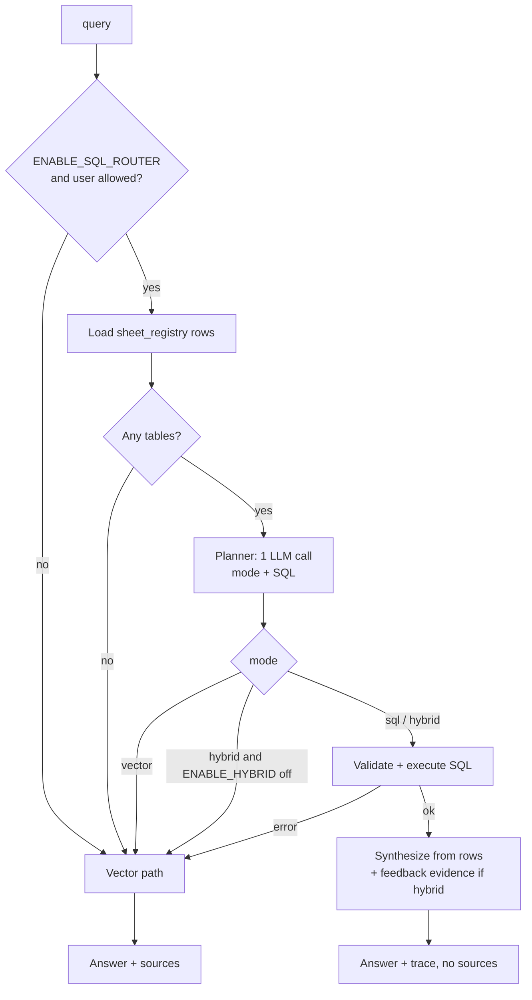

Every SQL-side failure (planner error, validation rejection, DB error, exception) returns `null` and falls through to vector search. The user always gets an answer from some engine.

### 5.3 Vector path

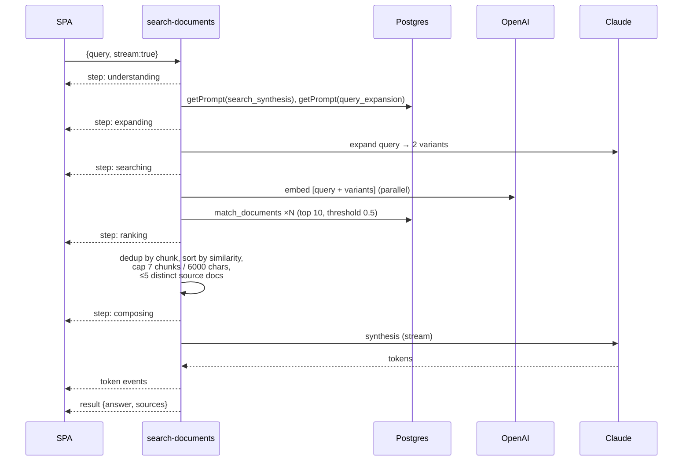

Details:

- **Query expansion** returns the original plus 2 LLM-generated paraphrases, to improve recall on vague or paraphrased queries. It fails soft to `[query]`.
- **Multi-query retrieval** runs one `match_documents` call per variant and merges by chunk id, keeping the highest similarity.
- **Sources** are the top distinct documents. Each carries a snippet (200 chars prose, 500 chars tabular) and the joined chunk text for the detail panel.
- **Synthesis** is grounded: "answer ONLY from chunks, cite the document, say so if not found". It runs at temperature 0 with a 25s timeout.
- **Empty retrieval** returns a fixed "couldn't find any relevant documents" message without calling the LLM.

---

## 6. Text-to-SQL subsystem

### 6.1 Planner

One LLM call (`route-and-generate.ts`) replaces the earlier separate router and generator calls. It receives the schema prompt (tables, column types, enum value sets or samples) and the question, and returns:

```json
{"mode":"sql|hybrid|vector","sql":"...","tables_used":["..."],"reason":"...","confidence":0.0}
```

Mode semantics:

- `sql`: counts, rates, sums, averages, rankings, filters.
- `hybrid`: a structured filter plus free-text customer feedback.
- `vector`: narrative or qualitative questions, or documents not in the tables.

It falls back to `vector` on timeout (15s), parse failure, an unexpected mode, or no tables.

### 6.2 Execution — defense in depth

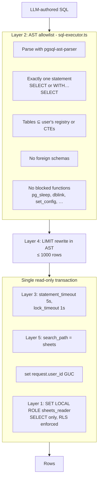

The five layers are independent. Any one of them is enough to stop a given class of attack:

| Layer | Mechanism | Stops |
|---|---|---|
| 1 | `sheets_reader` role + per-table RLS keyed on `request.user_id` | Writes, DDL, cross-user reads |
| 2 | AST allowlist | Multi-statement, non-SELECT, off-registry tables, dangerous functions |
| 3 | Statement and lock timeouts | Slow or lock-holding queries |
| 4 | AST LIMIT injection | Huge result sets |
| 5 | `search_path = sheets` | Unqualified references reaching `public` |

The role swap is done inside the app's transaction, because Postgres forbids `SET ROLE` inside a `SECURITY DEFINER` function. The `userId` is inlined into the setup batch, so it is regex-validated as a UUID first.

### 6.3 Synthesis

- **SQL mode.** The model gets the question and the rows (first 20 as a markdown table). The prompt forbids inventing numbers and asks for 2–4 sentences.
- **Hybrid mode.** The SQL rows are the authoritative numbers. Feedback evidence comes from vector chunks (top 20, threshold 0.2) whose `metadata.account_ids` intersect the `account_id` values in the SQL rows (up to 7 are used). The answer states the numbers and quotes 2–3 verbatim phrases. If nothing matches, it degrades to a feedback-aware SQL summary.

### 6.4 Trace

The SQL path returns `trace {mode, router_reason, router_confidence, sql, tables_used, row_count, truncated, model, exec_ms, evidence_chunks}`. The UI shows it in `AnswerTrace`. The `search_trace` table was designed for persistence but is not currently written.

---

## 7. Data architecture

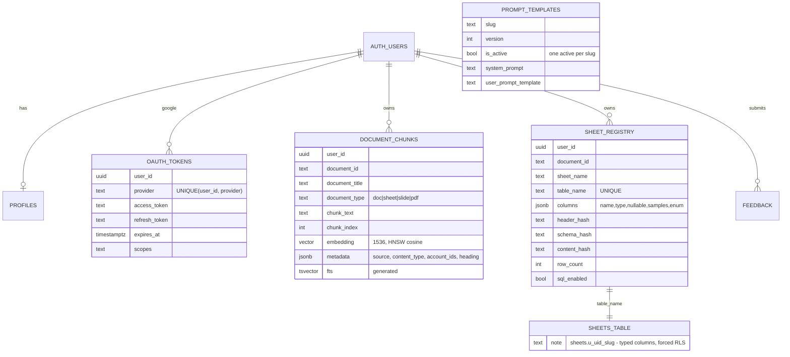

Supporting points:

- **Identity scoping.** Every user-owned row carries `user_id`. Public tables use `auth.uid() = user_id` RLS policies. The `sheet_registry` table also has a service-role policy.
- **Vector search** goes through the `match_documents` RPC, which filters by `user_uuid`. The embedding is 1536-dimensional (`text-embedding-3-small`) with an HNSW cosine index.
- **Hybrid keyword search** exists in the schema (`fts` column with a GIN index and the `keyword_search` RPC) but the app does not call it.
- **`prompt_templates`** is not user-scoped. It holds global, versioned prompts, seeded with v1–v4 synthesis and v1–v2 expansion variants.
- **`search_trace`** exists with RLS but is currently unused.
- **Per-user table naming** `u_<uid-hex>_<slug>` guarantees uniqueness and fits Postgres's 63-byte identifier limit by trimming the slug, never the uid.

---

## 8. Security model

| Concern | Control |
|---|---|
| Authentication | Supabase Auth (Google). Edge functions verify the JWT with `auth.getUser()`. |
| Tenant isolation (rows) | RLS on all public tables. Edge functions pass `user_id` explicitly when using the service role. |
| Tenant isolation (SQL mirror) | Per-table forced RLS on the `request.user_id` GUC, readable only by `sheets_reader`. |
| LLM-generated SQL | Five-layer defense (section 6.2). |
| Google data access | Readonly scopes only. |
| Secrets | Server-side only (Supabase secrets). The frontend holds only the public Supabase URL and publishable key. |
| Frontend | Must not use `supabase.auth.admin`. |
| CORS | `Access-Control-Allow-Origin: *`. The functions rely on JWT auth, not origin. |

Points to be aware of:

- `store-oauth-tokens`, `index-documents`, `search-documents`, and `delete-account` use user JWTs. They are listed with `verify_jwt = false` in `config.toml`, so the in-function `getUser()` check is the real gate.
- OAuth tokens are stored in plaintext in `oauth_tokens` (protected by RLS).
- "Delete account" calls `delete-account`, which drops that user's `sheets.u_*` tables and then deletes the auth user.

---

## 9. LLM abstraction and prompt management

### 10.1 `_shared/anthropic.ts`

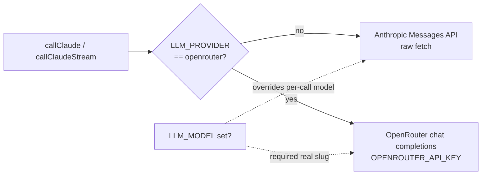

- It uses raw `fetch` with no SDK, because this is a Deno project.
- Timeouts are enforced with `AbortController` (defaults: 15s for calls, 25s for streams).
- `parseJsonLoose` tolerates code fences and trailing prose from smaller models.
- All LLM calls in the codebase go through it: query expansion, synthesis, planner, SQL and hybrid synthesis. This is what makes the model swap global.

### 10.2 Prompt registry

- Search synthesis and query expansion prompts live in `prompt_templates` and are loaded per request. A request can select a specific version with `prompt_version` or `qe_version`, which is how A/B experiments run.
- If the DB lookup fails, the function uses `FALLBACK_PROMPTS` hardcoded in `search-documents/index.ts`.
- Templates use `{{query}}` and `{{chunksContext}}` variables.
- The SQL planner, SQL synthesis and hybrid synthesis prompts are inline in code, not in the registry.

---

## 10. Frontend architecture

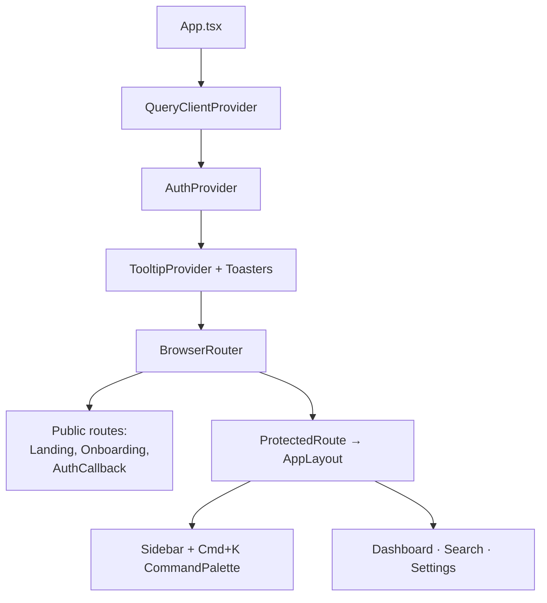

- **State.** `AuthContext` holds the session. React Query is set up with the default `QueryClient`, but pages mostly call `supabase` directly in `useEffect`. Forms use plain `useState` here (React Hook Form and Zod are available).
- **Search UI.** `streamSearch()` parses SSE manually, and `PipelineLoader` renders real backend steps. The first token swaps the loader for a growing markdown answer. Sources render as cards, with `TabularSnippet` for tabular content. `AnswerTrace` appears for SQL and hybrid answers.
- **Local persistence.** localStorage holds `pm-compass-recent-searches`, `pm-compass-indexed`, `pm-compass-chunk-settings`, and `pm-compass-sidebar-collapsed`.
- **Design system.** Dark premium (Vercel/Raycast style): Tailwind, shadcn/Radix primitives wrapped as `PM*` components, `glass` utilities, Framer Motion transitions, Lucide icons.

---

## 11. Deployment and operations

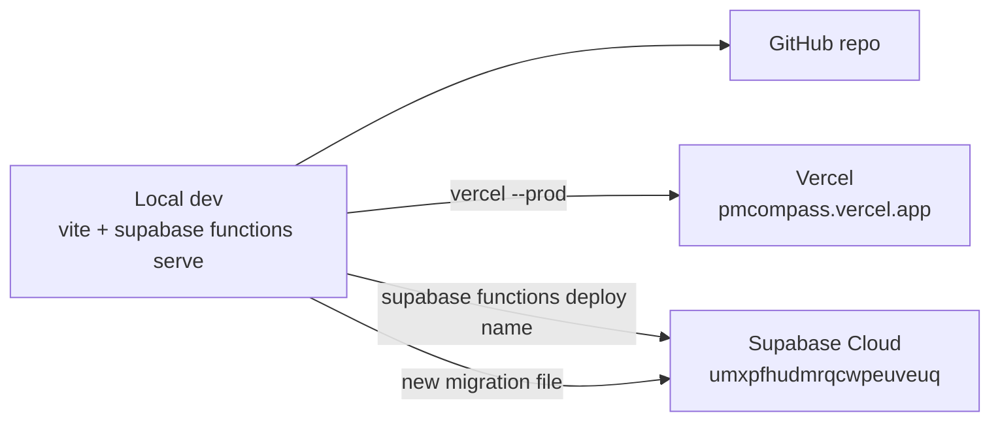

- **Frontend.** Vite build to `dist/`, with an SPA rewrite of all routes to `/` (`vercel.json`).
- **Backend.** Deploy each function individually.
- **Migrations.** Add timestamped SQL files and never edit applied ones.
- **Feature flags.** Backend secrets (`ENABLE_SQL_ROUTER`, `ENABLE_HYBRID`, `SQL_USER_ALLOWLIST`, `MATERIALIZE_SHEETS`) allow gradual rollout. SQL routing can be restricted to specific user ids.
- **Observability.** Currently `console.log`/`console.error` in the functions plus the in-response trace. No persisted per-query trace.

Rollout dependency chain for text-to-SQL: `MATERIALIZE_SHEETS=true` (create tables) → re-index or sync (populate `sheet_registry`) → `ENABLE_SQL_ROUTER=true` → optionally `ENABLE_HYBRID=true`.

---

## 12. Evaluation

The `evals/` directory is a Deno-based harness that calls the deployed functions as a real test user:

| Harness | Measures |
|---|---|
| `run-evals.ts` + `golden-dataset.json` | Recall@K, Precision@K, MRR, factual containment, citation accuracy, LLM-as-judge (1–5) |
| `run-sql-evals.ts` + `sql-golden.json` | Text-to-SQL answer correctness |
| `run-router-eval.ts` | Routing decisions (sql, vector, hybrid) |
| `reindex.ts`, `replace-doc-ids.ts`, `shift-dates.ts`, `apps-script/*` | Test data setup |

Re-run after changing chunking, thresholds, prompts, the planner, or the model. Results are saved as timestamped files in `evals/results/` (gitignored).

---

## 13. Design decisions and trade-offs

| Decision | Rationale | Trade-off |
|---|---|---|
| Supabase-only backend, no app server | Minimal ops. Auth, RLS, vectors and functions in one place. | Edge Function time and memory limits shape the design (batching, caps). |
| pgvector in the same Postgres | Joins with user data, single RLS model. | Scaling the vector index is tied to the main DB. |
| Two engines (vector + SQL) behind one router | Narrative questions need semantic search. Analytical questions need exact aggregates. | More surface area. Needs the fallback chain to stay trustworthy. |
| Single planner call (mode + SQL) | Removes one sequential LLM round-trip, the largest latency saving on the SQL path. | The one prompt carries both jobs. Planner quality affects both routing and SQL. |
| Always fall back to vector on SQL failure | The user never sees a broken or empty analytical answer. | Silent fallback can hide SQL-path bugs. Check the logs and trace. |
| Per-user physical tables with forced RLS | Real SQL with real types. Strong isolation. | Table-per-source growth. Table names in the schema prompt grow with the number of sheets. |
| LLM only sees schema and rows, and may only restate row values | Reduces numeric hallucination. | Synthesis is limited to the first 20 rows rendered. |
| Query expansion plus multi-query retrieval | Better recall on vague or paraphrased queries. | One extra LLM call and N embeddings per search. |
| Client-driven batch indexing | Fits Edge Function limits. Gives progress UI. | The client must stay open. Offset-based paging is fragile if the Drive file list changes mid-run. |
| SSE streaming with a buffered fallback | Responsive UX with real pipeline steps. | Two response code paths in one function. |
| Prompt registry in the DB | A/B test prompts without a deploy. | Prompts split between DB and inline code. |

---

## 14. Known limitations and tech debt

- **Chunk-size inconsistency.** Function defaults (800/200) differ from the Settings default (1600/400). Dashboard auto-index uses the function default.
- **Crude binary parsing.** PDFs and Office files are decoded as UTF-8, with poor quality.
- **Dataset-specific planner prompt.** Gotchas are written for the Ravenstack sample schema.
- **Unused schema.** `search_trace`, `keyword_search`, stored hashes not used for incremental resync.
- **Auth config stays local.** `config.toml` Site URL is `http://localhost:5173`. Production redirect URLs are set in the Supabase dashboard.
- **Token handling.** Expiry comes from Google tokeninfo. Tokens are stored unencrypted and rely on RLS.
- **No persisted observability** for query traces or LLM cost.
- **Default threshold is 0.5** (not 0.3 as in `CLAUDE.md`).

---

## 15. Extension points

| Goal | Approach |
|---|---|
| New data source (e.g. Notion, Jira) | Add an OAuth function, a sync function writing `document_chunks` and optionally `materializeCsvAsTable`, a Settings card, and a new `provider` value in `oauth_tokens`. The router and SQL path pick it up automatically. |
| Hybrid lexical + vector retrieval | `fts` and `keyword_search` already exist. Call the RPC from the vector path and merge (e.g. reciprocal rank fusion). |
| Persist traces | Write to `search_trace` in `search-documents` (the table and RLS exist). |
| Incremental table refresh | Use the stored `content_hash` and `schema_hash` in `materializeCsvAsTable` to skip or patch unchanged tables. |
| Better file parsing | Replace `sanitizeBinaryText` in `index-documents` with real PDF/Office extraction, or use the Drive export API for Office files. |
| Different model | Set `LLM_PROVIDER` and `LLM_MODEL`. No code change. |
| New search pipeline step | Emit `send("step", …)` in the function and add a label in `Search.tsx` `STEP_LABELS`. |

For file-level pointers for each of these, see the "Where to change things" table in [`context.md`](./context.md#9-where-to-change-things).
